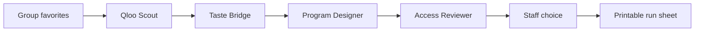

# MosaicHour

**Make room for what residents love.** MosaicHour helps senior living life-enrichment staff turn two shared cultural favorites into three group activity drafts. It is a separate Qloo Agentic Hackathon entry from Headcount.

The app takes a favorite musician and film, group size, session length, supply budget and an access priority. Staff see three Qloo-grounded options, choose one and print a run sheet. No sign-in or resident names are required.

## Why this problem

An [activity director describes](https://www.reddit.com/r/EventProduction/comments/1ih7xjn) a low-participation calendar, $300 per month for about 50 residents, and a request for 2–3 activities a day. [NCAL guidance](https://www.ahcancal.org/Assisted-Living/About-NCAL/Documents/GPforDementia%20Care.pdf) recommends tailoring activities to personal interests, strengths and ability to engage. A [LeadingAge case study](https://leadingage.org/wp-content/uploads/2019/04/Case-Study_Acts-Resident-Engagement_FINAL.pdf) shows this is a real category of operational spending; its reported outcomes are not MosaicHour results.

## What Qloo does

The Qloo Scout resolves both favorites with two `/search` calls. The Taste Bridge sends their combined entity IDs to three `/v2/insights` queries for related artists, films and books. The Program Designer uses those returned candidates to draft activities. The Access Reviewer checks that the selected cultural anchors actually appear in Qloo's results and adds staff review notes. The UI shows the candidate pools and an audit trail of all five Qloo calls. Qloo data is never committed to the repository; identical responses are cached in server memory for six hours.

The sample pair **Frank Sinatra + Casablanca** was live-tested against Qloo and yielded cross-category results including Billie Holiday, Ella Fitzgerald, *It's a Wonderful Life*, *Cinema Paradiso* and *The Great Gatsby*. The app's form is prefilled with that pair, but every plan is generated from live API calls or a private in-memory cache.

## How it works



- **Agent orchestration:** LangGraph with four sequential, separately accountable steps.
- **Generation:** Gemini 3.8 Flash drafts the activities. If the model is unavailable, a clearly logged template fallback keeps the core Qloo flow usable.
- **Guardrail:** Program anchors are checked against Qloo candidates; unsupported names are replaced and noted in the trace.
- **Human decision:** staff must select an activity before a run sheet appears. The app drafts and prints; it never sends messages or schedules events.
- **Accessibility:** staff can prioritize seated participation, hearing, vision or a quiet group. This adds review guidance, not a claim that an activity is clinically suitable.

## Run locally

```bash
cp .env.example .env
# Add QLOO_API_KEY and GEMINI_API_KEY to .env
uv sync
uv run uvicorn mosaichour.main:app --reload
```

Open `http://localhost:8000`. Run tests with `uv run pytest -q`.

## Honest limits

- MosaicHour has not been tested with a facility or measured against participation or staff-time outcomes.
- Budget is a supply ceiling entered by staff; the app does not price supplies.
- Staff must check content rights, availability, resident preferences and accessibility before running an activity.
- Plans and approvals are held in server memory and expire when the instance restarts.
- The app does not collect resident names, diagnoses or medication information, and it makes no clinical recommendations.

## Stack

Python 3.12 · FastAPI · LangGraph · Gemini · Qloo Taste AI · Cloud Run · HTML/CSS/JavaScript

MIT licensed.
